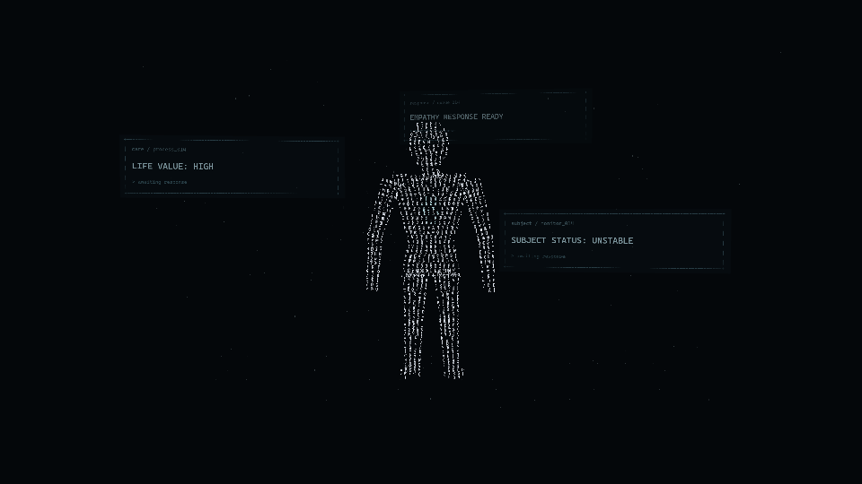

# T01 三帧审阅

范围仅 S01 的最小字符动画骨架。下列 PNG 来自实际 WebGL canvas 截图，均为 960×540，没有生成式图片、重画或后期修饰。

| 帧 | 本地时间 | 原曲时间 | 审阅重点 |
|---|---|---|---|
| [000](frame-000.png) | 0.000 s | 58.000 s | 头部、肩线、手臂、站姿；主体与三层窗口的关系 |
| [036](frame-036.png) | 0.600 s | 58.600 s | 字符密度、冷白明暗与文案可读性 |
| [071](frame-071.png) | 1.183 s | 59.183 s | S01 尾部构图、后景窗口与人物头部的关系 |

## 工程证据

- [build.txt](build.txt)：TypeScript 检查与 Vite 构建通过；Three.js 所在单入口 chunk 约 541 kB，有超过默认 500 kB 的构建提示，未阻止构建。
- [unit-tests.txt](unit-tests.txt)：38 项 Vitest 测试通过。
- [python-tests.txt](python-tests.txt)：13 项 Python 交接测试通过。
- [browser-report.json](browser-report.json)：已构建的本地预览，62/62 浏览器检查通过；包含 16 个指定边界、非法输入拒绝、3 PNG、换种子后的恢复与乱序像素 hash 检查。
- [browser-report.dev.json](browser-report.dev.json)：开发预览同样通过 62 项检查，三帧 PNG hash 与构建预览一致。
- [ui-report.json](ui-report.json)：12/12 试听控制与工作台交互检查通过；静音浏览器实际播放到本地时间 >0.15 s，duration=15 s，暂停与精确跳帧通过，解码无错误。没有进行人耳听审。

实际环境：Windows x64，Node 24.19.0，pnpm 11.25.0，Vite 8.3.4，TypeScript 7.0.2，Three.js 0.186.1，Vitest 5.0.3，Playwright 1.64.0，Edge 154.0.4258.62。GPU 为 ANGLE / AMD Radeon 780M / D3D11；完整环境在浏览器报告中。

字符图集声明字体栈为 `"Cascadia Mono", Consolas, "Courier New", monospace`。没有分发字体；浏览器 API 无法完整证明最终系统字体回退选择。像素一致只在本轮同一依赖、浏览器与 GPU 环境实测，不承诺跨硬件一致。

## 留给导演的问题

1. 当前人形比例、偏直的四肢与细小字符，是否适合“压抑建立”，还是需先局部调整肩部与站姿？
2. 三句主文案的明暗和后景窗经过头部下方的关系，是否保留？
3. 呼吸与胸口明灭较克制。请在本地工作台试听预览中评价其幅度与慢推；三张静帧不能证明动态节奏或音乐同步。

工程检查不代表艺术验收。S02–S08 画面、爆裂/重组、歌词/鼓点精校、MP4 与 1080p60 全序列尚未完成。本轮没有外部模型审阅或导演通过结论。
